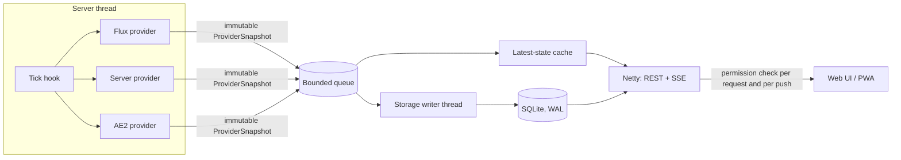

# Architecture

This document describes how Overseer is put together. The reasoning behind each choice
is in the [ADRs](adr/README.md); this page is the map.

## Modules

```
overseer/
├── core/                    Plain Java 17. No Minecraft.
│   ├── provider/            DataProvider contract, snapshots, metrics, access policy
│   ├── time/                Timestamp, UptimeClock (wall clock + server uptime)
│   ├── pipeline/            collector scheduler (budgets, throttling), bounded queue, latest state
│   ├── storage/             SQLite: migrations, sessions, single writer, deadband/heartbeat (rollups: M1b)
│   ├── auth/                link codes, console login tokens, sessions, device tokens, roles, rate limits
│   ├── access/              AccessService: admin bypass + provider policies, default deny
│   ├── http/                Netty server, router, SSE hub, static UI, origin check, proxy handling
│   ├── api/                 /api/v1 routes and JSON DTOs (mirror api/openapi.yaml)
│   ├── OverseerRuntime      wires everything; platforms call start(), tick(), close()
│   └── (M1a) sim/           simulator providers, record/replay
├── platform/forge-1.20.1/   Forge mod. The only code that touches Minecraft.
│   ├── OverseerForge        entry point, server-only display test, config registration
│   ├── ServerLifecycle      starts OverseerRuntime on server start, ticks it, closes on stop
│   ├── OverseerConfig       overseer-server.toml (bind, port, proxies, public URL)
│   ├── ForgeOperatorCheck   op lookup on the server thread, cached for HTTP threads
│   ├── command/             /ov commands (also console and RCON)
│   └── integration/         Integrations (provider list) + one package per mod: server, (M1a) flux, (M2) ae2
├── web/                     Vite + React + shadcn/ui, built into the jar at /overseer-web
└── api/openapi.yaml         HTTP contract; the TS client is generated from it
```

`(M1a)` marks packages that do not exist yet.

The mod jar contains the platform classes, the core classes and the built web UI, plus
`sqlite-jdbc` and `netty-codec-http` embedded via Forge Jar-in-Jar. Adding
a Minecraft version or loader means adding another `platform/<loader>-<version>/`
module; `core` and `web` do not change ([ADR-0002](adr/0002-module-structure.md)).

## Data flow



1. **Collect** (server thread). On each tick the collector checks which providers are
   due (`intervalTicks`). A due provider reads world and mod state and returns an
   immutable `ProviderSnapshot`. Time spent is measured against `budgetNanos`; providers
   that keep overrunning get a longer interval and are flagged in the admin UI.
2. **Hand off.** Snapshots go into a bounded queue. If it is full, the oldest entry is
   dropped and counted. The tick never blocks ([ADR-0004](adr/0004-threading-and-snapshots.md)).
3. **Latest state.** The newest snapshot per provider is kept in memory for live views
   and SSE.
4. **Store** (single writer thread). Events are stored always; metrics only when they
   leave the deadband or the heartbeat interval passed. Rollup and retention jobs run
   on the same thread in batches ([ADR-0005](adr/0005-data-model.md),
   [ADR-0006](adr/0006-storage-sqlite.md)).
5. **Serve** (Netty event loop + worker pool). REST for queries and history, SSE for
   live updates. Every response and every push is filtered by the viewer's permissions
   ([ADR-0008](adr/0008-permissions.md)).

## Threads

| Thread | Does | Must not |
|---|---|---|
| Server thread | `DataProvider.collect()`, commands | block on IO, DB or network |
| Storage writer | all SQLite writes, rollups, retention | touch world state |
| Netty event loop | HTTP parsing, SSE writes | run DB queries (hand off to workers) |
| HTTP workers | DB reads, response building | touch world state |

## Time

Every value carries a `Timestamp`: wall clock (UTC), accumulated server uptime in
milliseconds, and the uptime session number. Charts default to **server uptime** (offline
time collapsed to a marker) and can switch to **calendar time**. See
[ADR-0005](adr/0005-data-model.md).

## Security model (summary)

Bind to `127.0.0.1` by default; expose through a reverse proxy with TLS. Login by a
one-time code confirmed in-game; session in an HttpOnly cookie; device tokens as bearer
tokens; all secrets stored hashed. Server console is always super-admin. Details:
[ADR-0007](adr/0007-authentication.md).
